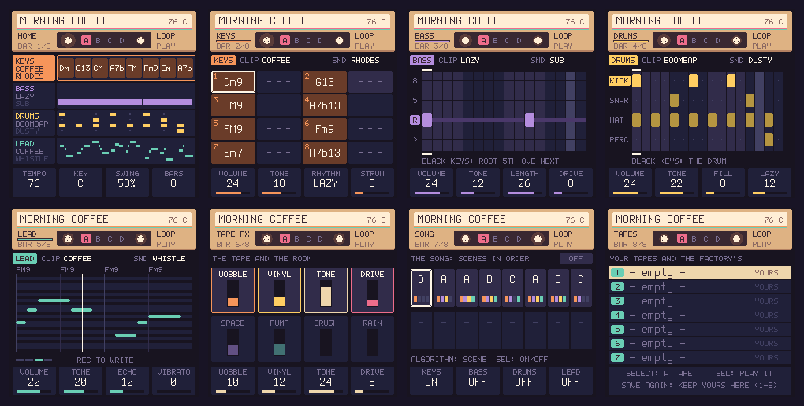

# Dusk for the M-VAVE FM-1

A lofi beat maker, and nothing else: the kind of beat that sits on a *morning coffee* or *study* playlist. Jazzy
chords on a soft electric piano, a sub bass under them, lazy drums, a small tune on top, and all of it through a
tired tape: wobble, vinyl crackle, a low-pass, rain on the window.

*Dusk*, for the hour it sounds like: the lamp on, the window going dark.

You build a beat from **clips**. A tape has four scenes (A B C D); a scene has one clip on each of four tracks:
KEYS, BASS, DRUMS and LEAD. Pick clips from the bank and it already sounds right; change one and it becomes your own.
Then put the scenes in order and you have a song.

<p align="center"></p>

> [!CAUTION]
> **Not yet tried on a real FM-1.** Version 0.1: built with the FM-1's toolchain and tested on every change, on a
> computer and in fm1-emu (the FM-1 emulator, where it takes about a quarter of the chip), but nobody has had it on
> an actual device yet. Install it at your own risk.

A [Dinghy 0.5](https://github.com/zvenson/dinghy) app, from the family of
[VaveHero](https://github.com/joakimskurk/fm1vavehero), [RoboSeq](https://github.com/joakimskurk/fm1roboseq),
[SkurkyMello](https://github.com/joakimskurk/fm1mello) and [FM-1 Clock](https://github.com/joakimskurk/fm1clock).

## The idea in a minute

1. Press **PLAY**. The first tape, *Morning Coffee*, loops its scene A.
2. Turn **SELECT** to a lane, **ALGORITHM** to give it another clip, **PRESETS** to give it another sound.
3. Turn the four knobs under the screen: the screen always says what they do on this page.
4. Open a track with its button to change the clip itself: chords on the keys, drum steps on the white keys, a
   tune you play.
5. **F G A B** on HOME are the scenes. Hold one and press another to copy it, then make the copy different.
6. **GLO** is the song: scenes in order. **SAVE** is the shelf: eight tapes of your own, eight from the factory.

## The same three knobs, everywhere

| Control | What it does |
|---|---|
| **SELECT** | The cursor: the lane, the chord, the step, the place in the song, the tape on the shelf. |
| **ALGORITHM** | The **clip** of this track, from the bank. 0 is **MINE**: your own; turning back to it brings it back. |
| **PRESETS** | The **sound** of this track (the kit, for the drums). |
| **KNOB 1–4** | What the bottom of the screen says. |
| **PLAY** | Start / stop. From the SONG page with the song on: the song, from the cursor. |
| **REC** | Lit: what the keys play is written (KEYS, LEAD). |
| **SEL** | Does the obvious thing at the cursor (below). Held on a track's page: empties that track's own clip. |
| **ENV** | Tap the tempo. |
| **OCT − / +** | This track an octave down / up. |

## The pages

The button of the page you are on is lit.

| Button | Page | Keys | SEL | Knobs |
|---|---|---|---|---|
| **HOME** | The four lanes of the scene. | **F G A B**: the scenes A B C D (hold one, press another: a copy). **C D E F**: KEYS, BASS, DRUMS, LEAD on / off. The keys above play the lead. | This lane on / off. | tempo, key, swing, bars |
| **ARP** | **KEYS**: the chords, a half bar each. | Every key is a chord. The lower octave: the key's own ninth chords and the borrowed ones between them. The upper octave: their restless relatives. With REC lit the chord goes where the cursor is (while playing: where the tape is). | The chord before goes on through here. | volume, tone, rhythm, strum |
| **LFO** | **BASS**: one bar. | The white keys are the 16 steps. The first black keys choose what a step plays: the chord's root, its fifth, its octave, or an approach to the next chord. | The step at the cursor. | volume, tone, length, drive |
| **SEQ** | **DRUMS**: one bar. | The white keys are the 16 steps: hit, ghost, nothing. The first black keys choose the drum: kick, snare, hat, perc. | The step at the cursor. | volume, tone, fill, lazy |
| **EDIT** | **LEAD**: the topline, as a piano roll. | They play. The white keys are always in key. REC lit and playing: what you play is kept, on the 16ths. REC lit and stopped: a key writes an eighth at the cursor. | Makes the note before longer, or takes a note away. | volume, tone, echo, vibrato |
| **FX** | The tape and the room. FX again: the other four. | Play the lead. | The other four. | wobble, vinyl, tone, drive / space, pump, crush, rain |
| **GLO** | The **SONG**: 16 places. | The white keys are the places. | The song on / off (off: the scene loops). | The four tracks on / off at this place. ALGORITHM puts a scene here. |
| **SAVE** | The **TAPES**: yours (1–8) and the factory's. | Play the lead. | Loads the tape. | SAVE again keeps your tape here. |

**The bank.** 14 chord progressions, 10 ways of playing them (the keys' RHYTHM), 8 bass lines, 10 grooves, 8
toplines; 8 sounds for the keys, 4 for the bass, 8 for the lead, 6 drum kits. A factory topline follows your
chords: a note that would clash moves to the nearest one that fits.

**The knobs worth knowing.** WOBBLE is the tape's wow and flutter (and, turned up, its dropouts). VINYL is crackle
and hiss. TONE on the FX page is the tape's low-pass; TONE on the drums' page is the blanket over the drums. PUMP
ducks everything under the kick. LAZY makes the snare late and the hats loose. FILL adds a little at the end of
every fourth bar. STRUM spreads the chords' notes.

**Keeping things.** The tape as it is, is kept by itself two seconds after you stop, and is there again at
power-on. The shelf (SAVE) is for keeping a tape for good. **MIDI in** (USB and the TRS jack): notes play the lead;
start, continue and stop are PLAY.

## Install and try

**Try it and install it from the browser:** [joakimskurk.github.io/fm1dusk](https://joakimskurk.github.io/fm1dusk/).
*Try it here* runs the firmware itself, compiled for the browser, with its screen, its panel, its keys and their
lights, in any recent browser; what you keep on the shelf stays in that browser. *Install* needs Chrome or Edge on
a computer and the FM-1 on USB; it always offers the latest build that passed its tests.

**Hear it on a computer:**

```sh
make tape N=1     # the first factory tape's song, as the FM-1 plays it: build/host/tape-1.wav (cc; N = 1..8)
make host         # a tour of the pages: build/host/fm1dusk.wav and the screens as PNG
```

**Install it** from a computer with Python, the FM-1 on USB (the package is built by CI on every push, and by
`make fw`):

```sh
python3 tools/fm1_install.py build/fm1dusk.fwsc     # asks before it writes, then restarts into Dusk
```

If anything goes wrong, hold **OCT−** while switching the FM-1 on: it starts in the USB rescue, where an installer
always works. Installing firmware is at your own risk.

**Build and test:**

```sh
make test     # the app's tests on a computer: no FM-1, no toolchain (cc, Python 3 with numpy and Pillow)
make gen      # firmware/gen/lofi_gen.h again, after changing the music in tools/gen_lofi.py
make fw       # the FM-1 package, build/fm1dusk.fwsc (the JieLi toolchain and the AC79 SDK: docs/DINGHY_README.md)
make emu      # the package in fm1-emu: how much of the chip it takes, that it plays and draws
sh web/app/build.sh   # Dusk for the browser: build/web/fm1dusk.wasm (clang and lld)
python3 web/make_site.py build/fm1dusk.fwsc VERSION build/site   # the web page: its installer, Dusk to try
```

## How it is made

- **The music is data** (`tools/gen_lofi.py`): the sounds in seconds and ratios, the chord bank, the clips and the
  factory tapes, written as a musician would write them (`"Dm9 . G13 . CM9 . A7b13 ."`), and turned into integer
  tables (`firmware/gen/lofi_gen.h`). A new progression, groove or tape is a line there and `make gen`.
- **The sound** (`firmware/src/lofi_engine.h`), all synthesised, integers only, in the audio interrupt: 13 FM
  voices (keys 8, bass 2, lead 3), four drum voices (a sine with a falling pitch, noise through a filter, a
  click), a tone and a level a track, a ping-pong echo and a reverb at half the sample rate, the kick's duck, and
  the tape: saturation, a delay line read back at a wandering speed, crackle, hiss, rain, a low-pass.
- **The clock** is the sample counter: a 16th is exact to a control block (0.36 ms), the off 16ths late by the
  swing. The strum, the lazy snare and the loose hats are events held back a few milliseconds.
- **The chords** lead into each other by themselves: every chord is four notes without its root, each placed
  where it falls in one octave from F3, so from one chord to the next the fingers barely move. The bass has the
  root.
- **The screen** (`firmware/src/lofi_draw.h`) is three bands, drawn only when they change: the cassette, the page,
  the knobs.
- **The tests** (`tests/run_lofi.sh`): the app on a computer plays a tape, opens every page, writes clips with the
  keys, keeps and loads tapes; the kicks are timed against the tempo and the swing; two runs must sound the same.
  CI builds the real package, runs Dinghy's platform tests on it and runs it in fm1-emu.

## Platform, licence and credits

- **Platform.** Dinghy 0.5 (zvenson), imported as source ([PLATFORM.md](PLATFORM.md)), built on
  [Felucca](https://github.com/hugelton/Felucca) by Leo Kuroshita (Hügelton Instruments) and carried by
  [SLOOP](https://github.com/isod89/sloop-fm1) (isod89). The package's identity is `FM-1_963`.
- **Licence.** GPL-3.0 ([LICENSE](LICENSE); who made what: [LICENSING.md](LICENSING.md)).
- **No samples.** Every sound is synthesised; the chords, clips and tapes are this firmware's own.
- **Thanks** to joakimeriksson for [fm1-emu](https://github.com/joakimeriksson/fm1-emu).
- **Trademarks.** "M-VAVE" and "FM-1" belong to their owners. This is a fan project, not an official M-VAVE product.
